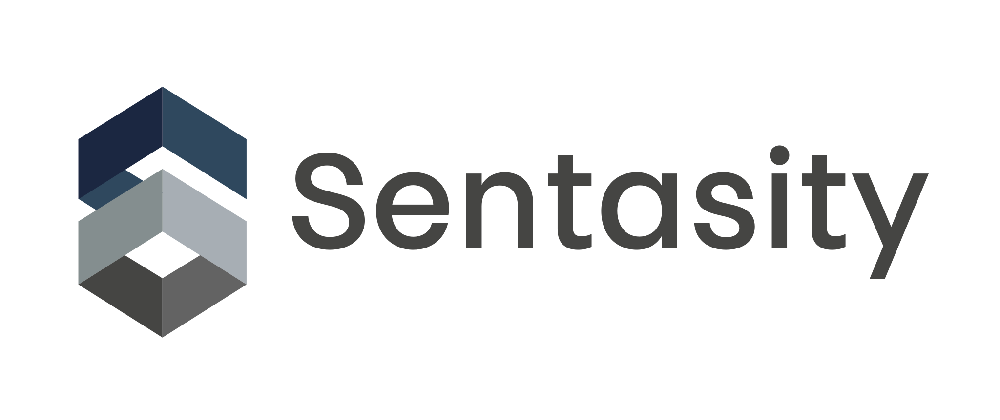

<p align="center">
  <a href="https://sentasity.com">
    <picture>
      <source media="(prefers-color-scheme: dark)" srcset="assets/sentasity-logo-dark.svg">
      
    </picture>
  </a>
</p>

<p align="center">
  <b>AWS cost and security findings, in your AI assistant.</b><br>
  <a href="https://sentasity.com">sentasity.com</a> ·
  <a href="https://docs.sentasity.com/setup-and-troubleshooting/setup/mcp-server/">Docs</a> ·
  <a href="mailto:support@sentasity.com">Support</a>
</p>

# Sentasity agent skills

[Sentasity](https://sentasity.com) finds waste and security risk across your AWS accounts. This repository connects your AI assistant to it, whichever assistant you use:

- **The Sentasity MCP server** at `https://api.sentasity.com/mcp`. Any assistant that supports remote MCP servers can connect to it and ask about your spend, savings opportunities, scan results and commitment recommendations, or set up your account in conversation.
- **Skills** in the open [Agent Skills](https://agentskills.io) format, which help an assistant work with the server. Today that's `business-setup`: a short conversation about what your business does, its industry and its compliance frameworks, saved only after you approve a preview.

The server works on its own; the skills add guidance on top for assistants that load them.

## Connect your assistant

Chat assistants sign in through your browser with your Sentasity account. Coding agents use an API key you create in the Sentasity portal (Settings > API Keys), or a browser sign-in where the agent supports it.

| Assistant | Connect the server | Add the skills |
|---|---|---|
| Antigravity CLI | Add the server to your MCP settings | Copy `.agents/skills/` into your project |
| ChatGPT | Add a custom connector with the server address | Not needed: the server works on its own |
| Claude (claude.ai and Claude Desktop) | Add a custom connector with the server address, or install the plugin below | Included in the plugin |
| Claude Code | Install the plugin below | Included in the plugin |
| Codex CLI | Add the server to your MCP settings | Copy `.agents/skills/` into your project |
| Cursor | Add the server to your MCP settings | Copy `.agents/skills/` into your project |
| Gemini (app) | Add a custom connector with the server address | Not needed: the server works on its own |
| Gemini CLI (paid plans and API keys) | Add the server to your MCP settings | Copy `.agents/skills/` into your project |
| VS Code Copilot | Add the server to your MCP settings | Copy the skills into `.github/skills/` in your project |

Step-by-step setup for each one is in [Connect your AI assistant](https://docs.sentasity.com/setup-and-troubleshooting/setup/connect-ai-assistant/).

### The Claude plugin

For Claude, this repository is also a plugin marketplace. The `sentasity` plugin bundles the server connection and the skills in one install:

```bash
claude plugin marketplace add sentasity/agent-skills
claude plugin install sentasity@sentasity-agent-skills
```

## What's in this repository

- `.agents/skills/`: the skills, in the Agent Skills layout that Antigravity CLI, Codex, Cursor and Gemini CLI read.
- `plugins/sentasity/`: the same skills packaged as a Claude plugin, with the server connection.
- `.claude-plugin/marketplace.json`: the marketplace entry for that plugin.

## Documentation and support

- MCP server reference: https://docs.sentasity.com/setup-and-troubleshooting/setup/mcp-server/
- Support: support@sentasity.com
